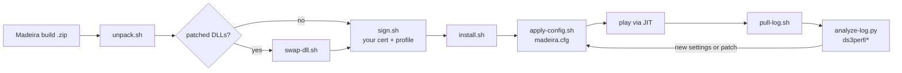

<p align="center">
  
</p>

<h1 align="center">Madeira Kit</h1>

<p align="center"><b>Run heavy Windows x64 games on your iPhone - the missing guide, scripts and measurements for Madeira (FEX-Emu + Wine + DXMT).</b></p>

<p align="center">
  
  
  
  
  
</p>

<p align="center">
  <a href="#quick-start">Quick start</a> ·
  <a href="#features">Features</a> ·
  <a href="#how-it-works">How it works</a> ·
  <a href="README.ru.md">Русский</a>
</p>

> [!IMPORTANT]
> **Bring your own legally owned copy of every game.** This repository contains no game files, no extracted assets, no save editors and no copy-protection or anti-tamper circumvention, and it will never accept them.

## Results at a glance

| 🎮 Title | 📱 Result on iPhone Air | 📎 Details |
|---|---|---|
| Dark Souls Remastered | **Playable**: title, load character, in-game, settings, on-screen Xbox pad | [bugs found & fixed](docs/bugs-and-fixes.md) |
| Dark Souls III | **~20 FPS stock -> 36.7 FPS median** in heavy scenes (first minutes), 32-34 after heat-up, with the experimental package | [compatibility](docs/compatibility.md) · [perf notes](docs/perf/README.md) |
| Upstream | **5 merged + 11 open PRs** to Madeira / Wine / FEX / DXMT | [upstream.md](docs/upstream.md) |

Single device, single tester; see [limitations](#limitations).

## Why

[Madeira](https://github.com/willfaust/Madeira) is a remarkable piece of engineering, but getting a *specific* heavy game to run well takes a lot of unwritten knowledge: how to re-sign the app with the right entitlements, which of dozens of config keys help, how to tell from a log what actually went wrong. This kit writes that down and automates the boring parts - with measurements instead of folklore, and every code fix sent upstream rather than hoarded.

## Features

| | |
|---|---|
| 🔏 **Sign & install** | one-config scripts: unpack a Madeira zip, swap in patched DLLs, re-sign with your own certificate, install keeping app data |
| 🩺 **Pre-flight doctor** | phone on USB? app installed? free space? game copy present? Wine profile complete? |
| ⚙️ **Config profiles** | verified upload of `madeira.cfg` (read-back compare), ready profiles for DS1 and DS3, on-screen keyboard layout |
| 🔍 **Log analyzer** | what env Madeira really accepted, module order, faults with registers, graphics/window/audio up?, how it ended |
| 📊 **Perf parsers** | turn a run log into FPS / GPU / CPU-frequency / thread tables per phase and per minute |
| 🧪 **Reference patches** | the changes behind the numbers, as patches against Madeira, Wine, FEX and DXMT |
| 📚 **Field notes** | 22 deep-dive notes (Russian) with an English index; a catalogue of 8 bugs, causes and fixes |

## Quick start

Requirements: a Mac with Xcode command line tools, an iPhone connected by USB, an Apple Developer certificate + provisioning profile for **your** bundle id, [StikDebug](https://github.com/StikDebug/StikDebug) for JIT, `pip3 install pymobiledevice3`, and a Madeira build zip (from upstream or your own CI).

```bash
git clone https://github.com/meshoklv/madeira-kit && cd madeira-kit
cp scripts/config.example.env scripts/config.env && $EDITOR scripts/config.env   # bundle id, team, identity, profile, device ids
scripts/unpack.sh ~/Downloads/Madeira-build.zip && scripts/sign.sh && scripts/install.sh
```

Then put **your own** game on the phone and apply a profile:

```bash
scripts/doctor.sh                                  # pre-flight
scripts/apply-config.sh configs/ds1-play.cfg       # upload + verify madeira.cfg, fix Wine profile
# swipe Madeira away, enable JIT in StikDebug, start the game, then:
scripts/pull-log.sh first-run                      # fetch the log and analyse it
```

Full walkthrough with troubleshooting: [docs/guide.md](docs/guide.md).

> [!NOTE]
> **Tested on:** the author's setup (iPhone Air, iOS 27.2 beta, macOS). **Not yet tested:** other iPhones/iOS versions, a fresh checkout on a second machine. The scripts are the author's working pipeline with personal identifiers replaced by `config.env`; they were syntax-checked after that cleanup but not re-run end to end on a device.

## How it works



Madeira runs x64 Windows code on iOS with FEX-Emu (x86-64 -> ARM64 JIT), Wine (Windows API) and DXMT (Direct3D 11 -> Metal). The kit wraps the loop around it: build -> sign -> install -> configure -> run -> read the log -> change one thing. Where a log pointed at a real bug or a bottleneck, the fix went upstream as a PR (see [upstream.md](docs/upstream.md)) and a reference patch is kept in [`patches/`](patches).

## Configuration

`scripts/config.env` (copy of [`config.example.env`](scripts/config.example.env), git-ignored):

| Variable | Meaning |
|---|---|
| `BUNDLE_ID`, `TEAM_ID` | your registered bundle id and Apple Team ID |
| `SIGN_IDENTITY` | certificate name or SHA-1 from `security find-identity -v -p codesigning` |
| `PROVISIONING_PROFILE` | path to your `.mobileprovision` |
| `DEVICE_UDID`, `DEVICE_ID` | usbmux UDID and CoreDevice id of the phone |
| `WORK_DIR`, `LOG_DIR` | unpacked app and pulled logs |
| `GAME_DIR`, `GAME_EXE` | where your game copy lives inside the app container |

Nothing in the repo is a secret; `.gitignore` also blocks profiles, certificates, `.env`, game binaries, saves and logs.

<details>
<summary><b>Repository layout</b></summary>

```
scripts/   unpack, swap-dll, sign, install, doctor, apply-config, pull-log, device.py
configs/   ds1-play.cfg, ds3-ux.cfg, ds3-h2-experimental.cfg, touch-layout-keyboard.json
tools/     analyze-log.py, ds3perf/ (parse, phases, bins, threads)
patches/   merged/ and open/ reference patches (Madeira, Wine, FEX, DXMT)
docs/      guide, compatibility, bugs-and-fixes, upstream, perf/ (22 notes)
```
</details>

## Limitations

- One device, one tester, mostly one run per configuration. The DS3 "36.7 FPS" is a *sum* of several changes after a short, cool-phone run; sustained play is 32-34 FPS and the phone gets hot.
- The experimental package needs patched DLLs built from open PRs; keys are no-ops on stock builds.
- Notes in `docs/perf/` are Russian; each carries `[fact]` / `[hypothesis]` tags (`[факт]` / `[версия]`).
- Apple signing needs a developer account; free accounts may not grant the entitlements Madeira needs.

## FAQ

**Does this include cracks, bypasses or game files?** No. Only setup scripts, configs, measurements and emulator patches. You supply your own legally owned game.

**Why not just fork Madeira?** Fixes go upstream so everyone benefits; the patches here are reference copies behind the reported numbers.

**Will my phone get hot?** Yes in heavy 3D games; the notes in [DS3-POWER.md](docs/perf/DS3-POWER.md) explain the CPU clamp and what frame caps buy.

## Contributing

Compatibility reports and measured configs are very welcome - see [CONTRIBUTING.md](CONTRIBUTING.md) (and what is out of scope).

## License

[MIT](LICENSE) for the scripts, tools, configs and docs. Patches follow the licenses of the projects they target - see [THIRD_PARTY_NOTICES.md](THIRD_PARTY_NOTICES.md).

---

Made by [@meshoklv](https://github.com/meshoklv)
