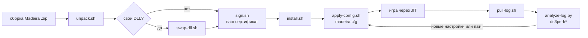

<p align="center">
  
</p>

<h1 align="center">Madeira Kit</h1>

<p align="center"><b>Тяжёлые Windows x64-игры на iPhone: недостающее руководство, скрипты и замеры для Madeira (FEX-Emu + Wine + DXMT).</b></p>

<p align="center">
  
  
  
  
  
</p>

<p align="center">
  <a href="#быстрый-старт">Быстрый старт</a> ·
  <a href="#возможности">Возможности</a> ·
  <a href="#как-это-устроено">Как устроено</a> ·
  <a href="README.md">English</a>
</p>

> [!IMPORTANT]
> **Игры - только ваши, купленные легально.** В репозитории нет файлов игр, извлечённых ресурсов, редакторов сохранений и обхода защиты от копирования/анти-тамперинга - и таких вещей сюда не примут.

## Коротко о результатах

| 🎮 Игра | 📱 Результат на iPhone Air | 📎 Подробности |
|---|---|---|
| Dark Souls Remastered | **Играбельно**: заставка, загрузка персонажа, игра, настройки, экранный Xbox-геймпад | [найденные баги](docs/bugs-and-fixes.md) |
| Dark Souls III | **~20 FPS из коробки -> 36,7 FPS медиана** в тяжёлых сценах (первые минуты), 32-34 после нагрева, с экспериментальным пакетом | [совместимость](docs/compatibility.md) · [заметки по скорости](docs/perf/README.md) |
| Upstream | **5 принятых и 11 открытых PR** в Madeira / Wine / FEX / DXMT | [upstream.md](docs/upstream.md) |

Одно устройство, один тестер - см. [ограничения](#ограничения).

## Зачем

[Madeira](https://github.com/willfaust/Madeira) - сильный проект, но чтобы *конкретная* тяжёлая игра на нём пошла хорошо, нужно много неписаных знаний: как переподписать приложение с нужными правами, какие из десятков настроек реально помогают, как по журналу понять, что сломалось. Здесь это записано и частично автоматизировано - с замерами вместо слухов, а каждая правка кода отправлена в upstream, а не припрятана.

## Возможности

| | |
|---|---|
| 🔏 **Подпись и установка** | скрипты с одним конфигом: распаковать zip Madeira, подложить пропатченные DLL, подписать своим сертификатом, установить с сохранением данных приложения |
| 🩺 **Проверка перед запуском** | телефон по USB? приложение стоит? место есть? копия игры на месте? профиль Wine полный? |
| ⚙️ **Профили настроек** | загрузка `madeira.cfg` с проверкой чтением обратно, готовые профили для DS1 и DS3, раскладка экранной клавиатуры |
| 🔍 **Разбор журнала** | какие env Madeira реально приняла, порядок модулей, исключения с регистрами, поднялись ли графика/окно/звук, чем закончилось |
| 📊 **Парсеры скорости** | из журнала - таблицы FPS / GPU / частоты CPU / потоков по фазам и по минутам |
| 🧪 **Референсные патчи** | правки, за которыми стоят цифры, - патчами к Madeira, Wine, FEX и DXMT |
| 📚 **Заметки** | 22 подробные заметки (на русском, с английским индексом); каталог из 8 багов с причинами и решениями |

## Быстрый старт

Нужно: Mac с Xcode command line tools, iPhone по USB, сертификат Apple Developer и provisioning-профиль на **ваш** bundle id, [StikDebug](https://github.com/StikDebug/StikDebug) для JIT, `pip3 install pymobiledevice3` и zip со сборкой Madeira (из upstream или из своего CI).

```bash
git clone https://github.com/meshoklv/madeira-kit && cd madeira-kit
cp scripts/config.example.env scripts/config.env && $EDITOR scripts/config.env   # bundle id, team, сертификат, профиль, id телефона
scripts/unpack.sh ~/Downloads/Madeira-build.zip && scripts/sign.sh && scripts/install.sh
```

Затем положите на телефон **свою** игру и примените профиль:

```bash
scripts/doctor.sh                                  # проверка перед запуском
scripts/apply-config.sh configs/ds1-play.cfg       # загрузить и проверить madeira.cfg, починить профиль Wine
# смахните Madeira, включите JIT в StikDebug, запустите игру, затем:
scripts/pull-log.sh first-run                      # забрать журнал и разобрать
```

Полное руководство и разбор проблем: [docs/guide.md](docs/guide.md) (на английском).

> [!NOTE]
> **Проверено:** на установке автора (iPhone Air, iOS 27.2 beta, macOS). **Не проверено:** другие iPhone и версии iOS, чистая установка на второй машине. Скрипты - рабочий конвейер автора, где личные идентификаторы заменены на `config.env`; после этой чистки проверен только синтаксис, полный прогон на устройстве не повторялся.

## Как это устроено



Madeira запускает x64-код Windows на iOS: FEX-Emu (JIT x86-64 -> ARM64), Wine (API Windows), DXMT (Direct3D 11 -> Metal). Кит оборачивает цикл вокруг неё: сборка -> подпись -> установка -> настройки -> запуск -> журнал -> меняем одну вещь. Если журнал указывал на настоящий баг или узкое место, правка уходила в upstream PR-ом (см. [upstream.md](docs/upstream.md)), а референсная копия лежит в [`patches/`](patches).

## Настройка

`scripts/config.env` (копия [`config.example.env`](scripts/config.example.env), в git не попадает):

| Переменная | Смысл |
|---|---|
| `BUNDLE_ID`, `TEAM_ID` | ваш bundle id и Apple Team ID |
| `SIGN_IDENTITY` | имя сертификата или SHA-1 из `security find-identity -v -p codesigning` |
| `PROVISIONING_PROFILE` | путь к вашему `.mobileprovision` |
| `DEVICE_UDID`, `DEVICE_ID` | UDID (usbmux) и id CoreDevice телефона |
| `WORK_DIR`, `LOG_DIR` | распакованное приложение и забранные журналы |
| `GAME_DIR`, `GAME_EXE` | где лежит ваша копия игры внутри контейнера приложения |

Секретов в репозитории нет; `.gitignore` дополнительно не пускает профили, сертификаты, `.env`, бинарники игр, сохранения и журналы.

<details>
<summary><b>Структура репозитория</b></summary>

```
scripts/   unpack, swap-dll, sign, install, doctor, apply-config, pull-log, device.py
configs/   ds1-play.cfg, ds3-ux.cfg, ds3-h2-experimental.cfg, touch-layout-keyboard.json
tools/     analyze-log.py, ds3perf/ (parse, phases, bins, threads)
patches/   merged/ и open/ - референсные патчи (Madeira, Wine, FEX, DXMT)
docs/      guide, compatibility, bugs-and-fixes, upstream, perf/ (22 заметки)
```
</details>

## Ограничения

- Одно устройство, один тестер, чаще всего по одному прогону на конфигурацию. «36,7 FPS» в DS3 - это *сумма* нескольких правок на коротком прогоне с холодным телефоном; в долгой игре 32-34 FPS и телефон греется.
- Экспериментальному пакету нужны пропатченные DLL из открытых PR; на стандартных сборках ключи ничего не делают.
- Заметки в `docs/perf/` на русском; в тексте теги `[факт]` / `[версия]` / `[оценка]` показывают, насколько утверждение надёжно.
- Для подписи нужен аккаунт разработчика Apple; бесплатный может не выдать права, которые нужны Madeira.

## FAQ

**Есть ли тут кряки, обходы защиты или файлы игр?** Нет. Только скрипты настройки, конфиги, замеры и патчи эмулятора. Игру вы приносите свою, купленную легально.

**Почему не форк Madeira?** Правки уходят в upstream, чтобы пользу получили все; патчи здесь - референсные копии за опубликованными цифрами.

**Телефон будет греться?** Да, в тяжёлых 3D-играх; в [DS3-POWER.md](docs/perf/DS3-POWER.md) разобрано, как срабатывает зажим CPU и что даёт ограничение кадров.

## Участие

Отчёты о совместимости и измеренные конфиги очень приветствуются - см. [CONTRIBUTING.md](CONTRIBUTING.md) (там же, что не принимается).

## Лицензия

[MIT](LICENSE) для скриптов, инструментов, конфигов и документации. Патчи следуют лицензиям проектов, к которым они написаны, - см. [THIRD_PARTY_NOTICES.md](THIRD_PARTY_NOTICES.md).

---

Сделал [@meshoklv](https://github.com/meshoklv)
